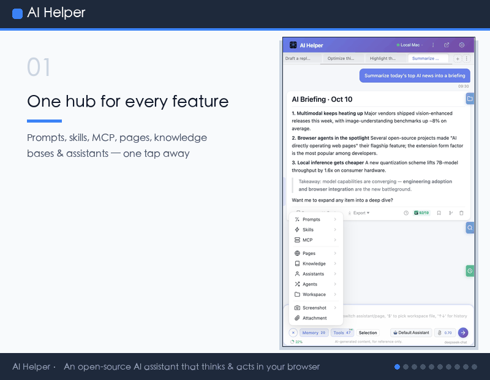

> [English](./README.md) | [中文](./README.zh-CN.md)

# AI Helper

### The open-source browser extension that lets LLMs actually operate web pages

Not just chat — it clicks, fills forms, drags, uploads files, runs terminal commands, and extends via MCP.

       

### [Install on Chrome Web Store →](https://chromewebstore.google.com/detail/ai-helper-%E7%BD%91%E9%A1%B5%E6%99%BA%E8%83%BD%E5%8A%A9%E6%89%8B/fnolhphogjkdcmnecpeckhjoeofldiac) · [Install on Microsoft Edge →](https://microsoftedge.microsoft.com/addons/detail/ai-helper-%E7%BD%91%E9%A1%B5%E6%99%BA%E8%83%BD%E5%8A%A9%E6%89%8B/kabhmgfbkhpbfhhnokaafhkdbckeipcl)

Chromium users without a store account: see the developer-mode load step in the [30-second quickstart](#30-second-quickstart) below.

---

One sentence to make AI read pages, fill forms, upload files, and run commands.

---

## Demo Videos

**AI Helper product introduction** (~4 min · narrated): complete walkthrough of the ReAct reasoning loop, 40+ built-in tools, multi-agent collaboration, workspace management, Skill system and MCP protocol — see how the browser assistant thinks and acts.

- ▶️ English: [Watch on YouTube](https://www.youtube.com/watch?v=6UtuvmZ1Pm8)
- ▶️ 中文版：[在线观看（Bilibili）](https://www.bilibili.com/video/BV1tZHZ6NEAr/)

**AI plugin fills batch forms automatically** (67s · narrated & subtitled): attach an Excel sheet and order in one sentence — the plugin opens the form page, reads rows one by one, fills every field and submits, ending with a split-screen check against the source data.

- ▶️ English: [Watch on YouTube](https://www.youtube.com/watch?v=mA1x2QiuXPo)
- ▶️ 中文版：[在线观看（Bilibili）](https://www.bilibili.com/video/BV1E5Hf6WECq/)

## What it can do for you

- **Fill a complex form and upload attachments with one sentence** — AI locates the fields, types the values, and submits. Shadow DOM and React controlled components included.
- **Summarize any open tab (Bilibili / YouTube / PDF / long article) and export to Word or PDF** — type `@`, pick the tab, ask for a summary, click export.
- **Watch a page on a schedule** — Cron / interval / one-off tasks re-run your prompt against a bound URL and write results into a chosen session.
- **Let AI touch your local files and terminal** — optional Agent service, with three-tier command safety and a 7-day trash bin as a safety net.
- **Never miss a generated file** — files the AI produces via scripts (e.g. an exported spreadsheet) now surface in the Artifacts panel, and any file path it mentions in its answer is clickable to locate and highlight it in the sidebar's built-in workspace.
- **Ask your own documents** — build a local knowledge base from PDF / Word / Excel / PPT / Markdown / HTML / CSV, then get retrieval-augmented answers with clickable citations; multiple bases can be searched together.
- **Talk instead of typing** — click 🎤 in the input box or press `Alt+V` (works with page focus too; right Alt / right Ctrl can be enabled as single-key triggers under Options → Voice): a draft appears as you speak and is **refined sentence by sentence** by default (Instant / Balanced / Precise under Options → Voice → Recognition pacing), then the whole clip is re-transcribed to fix punctuation and numbers; the microphone is pickable and falls back to the system default if unplugged. All transcription happens locally in the Agent — the audio never leaves your machine and no cloud ASR is involved.
- **Hand over a whole task and walk away** — light 🎯 in the input area to enter **goal mode**: the round becomes a session goal, and every time the model says it is done an independent short call (temperature 0, one JSON verdict) checks whether that is true. Unmet → it continues with a correction; met → it stops; impossible → it says so honestly. 20 finalize attempts by default, time bounded by the overall loop timeout, and hitting the cap grants another 20 on Resume. Sensitive-action approval is shown as a "🔓 auto-approved" badge on the goal bar and revocable in one click, while agent-side denylisted commands are refused regardless of any switch.
- **Jot things down without leaving the chat** — the sidebar's right rail carries a sixth entry, a **todo list** with an unfinished badge: two tabs (todo / done), three states, priority bars, links, drag ordering, `Alt+T` to toggle and `Alt+A` to focus the add box, JSON export/import (merge or replace all), completion-rate and 7-day stats, and one-click conversion of a single item into a prompt.
- **Bring any provider, switch in two clicks** — save multiple OpenAI-compatible provider profiles (endpoint / key / model list); pick provider first, then model, right in the chat panel.
- **Never miss an unfinished task** — desktop notifications when a task completes or fails, when a scheduled task finishes, and when the AI is waiting for your confirmation or clarification; one click jumps back to the side panel.
- **Run several sessions at once without flipping between them** — a rail on the left edge shows every other session as running / queued / done, with the current node and sub-task progress. The tooltip leads with the question you actually asked, and one click scrolls to it and highlights it. Finished sessions stay until you have seen them, a long list collapses into `+N`, and a wedged status greys out and becomes removable. Sessions you are done with but cannot bring yourself to delete go to the archive area: messages and workspace binding are kept intact, restore or delete permanently whenever you like, and the tab bar, session list and global search all hide them together.
- **Light / Dark / Follow-system theme** — a semantic-token redesign across the whole UI, switchable instantly from the sidebar "More" menu and the Options "Appearance" card; a change anywhere syncs every page without a reload.

## How it compares

| Capability | Closed-source commercial AI extension | Browser-automation code framework | Chat-only sidebar | **AI Helper** |
|---|---|---|---|---|
| Open source | No | Yes | Partial | **Yes (MIT)** |
| Setup cost | Install + subscribe | Write Python / JS | Install | **Install and go** |
| Actually clicks / fills / uploads | Partial | Yes | No | **Yes** |
| Local file read-write + terminal commands | No | DIY | No | **Yes (optional Agent)** |
| MCP protocol extension | Few | DIY | No | **Yes** |
| Built-in knowledge base (RAG) with citations | Partial | DIY | No | **Yes (optional Agent)** |
| Local speech-to-text input (no cloud ASR) | No | DIY | No | **Yes (optional Agent)** |
| Multi-agent collaboration / sub-task dispatch | No | DIY | No | **Yes** |
| Tool preselection + token-budget savings | No | DIY | No | **Yes** |
| Reflection quality assurance | No | DIY | No | **Yes** |
| Scheduled tasks + checkpoint resume | Few | DIY | No | **Yes** |
| Data stays local / under your control | No | Yes | Partial | **Yes** |

## Why not just use another AI sidebar?

- **Reflection quality assurance.** Preselection → zero-cost tool observation hint → sub-task reflection → post-reflection. Every final answer is scored on 7 dimensions; below-threshold runs get revised or re-executed automatically.
- **Objective sub-task completion checks.** Sub-tasks from `plan_task` can declare `doneCriteria` acceptance checks verified with real DOM / command evidence (penetrating Shadow DOM and same-origin iframes) instead of trusting the model's self-report; an optional auto-rerun loop drives unmet sub-tasks back through four gates (fully byte-for-byte unchanged when left off).
- **Tool preselection saves tokens.** 40+ tool definitions would blow up every call. A lightweight API pre-pass narrows them down to the 5–10 that actually matter before the main model runs.
- **Token-budget management.** Truncation is by token count, not message count, so `tool_calls` / `tool` message pairs never get split apart.
- **Long-quote auto-compression.** Big page selections are summarized instead of squatting in your context forever.
- **Built-in knowledge base (RAG).** Import your own documents and get hybrid-retrieval answers with source citations — the index lives on your machine and the files never leave it.
- **Voice input that never leaves the machine.** Say it instead of typing it: the Agent runs a local ONNX speech recognizer, refining each sentence as you speak (Instant / Balanced / Precise pacing) and re-transcribing the clip on release for punctuation and numbers. The audio never leaves your machine and no cloud ASR key is needed. Comes with a 24-bar recorder strip, silence detection, a pickable microphone, one-shot `Alt+V` that also fires while the focus is on the page (right Alt / right Ctrl can be enabled as single-key triggers), and a switch to cancel with `Esc`.
- **Goal mode turns "ask once" into "get it done".** The 🎯 chip makes a round a session goal: after each self-declared completion an independent temperature-0 call returns a single JSON verdict, and unmet goals continue with an explicit correction instead of quietly stopping. Budgets are bounded (20 attempts, overall loop timeout), the approval it grants is visible and revocable, and `clarify_question` is dropped for that run because a dialog nobody answers is just a five-minute stall.
- **Checkpoint resume + Service Worker restart recovery.** Long tasks survive SW silent restarts and can be resumed with one click after any interruption.
- **Scheduled tasks + long-term memory + file trash bin + audit logs.** The unglamorous pieces that turn an AI chat toy into something you can actually rely on day after day.

## Starter scenarios

**A. Auto-fill a complex form + upload a file.** Attach the file, tell the AI what to fill, watch it locate the fields, type values, and submit — Shadow DOM and React controlled components included. [Details →](docs/en/DOCUMENTATION.md#22-shadow-dom-deep-penetration)

**B. Summarize the current tab and export.** Type `@`, pick the active tab, ask for a summary, then export to Word / PDF / image / JSON from the message action bar. [Details →](docs/en/DOCUMENTATION.md#14-message-operations)

**C. Scheduled page-watch.** Every day at 9am, re-run a prompt against a bound URL and drop the result into a chosen session. Cron / interval / one-off all supported, with run history and failure notifications. [Details →](docs/en/DOCUMENTATION.md#30-scheduled-tasks)

**D. Ask your own knowledge base.** Start the Agent, import documents into a knowledge base from Options → Knowledge Base, then ask away in the side panel — answers come back with citation bubbles pointing at the exact source chunks. [Technical details →](agent/README.md#knowledge-base-rag)

**E. Speak instead of typing.** Enable the optional voice component (Options → Voice tab, one click) and drop a model pack into the Agent, then press `Alt+V` — anywhere, including while reading a page (or a single right Alt / right Ctrl once enabled under Options → Voice). A streaming draft appears as you speak; when you stop, a higher-accuracy pass adds punctuation and normalizes numbers. Nothing is sent automatically. [Setup & model pack →](docs/Voice-Input-Local-STT.md)

## 30-second quickstart

1. **Install** — one click from the [Chrome Web Store](https://chromewebstore.google.com/detail/ai-helper-%E7%BD%91%E9%A1%B5%E6%99%BA%E8%83%BD%E5%8A%A9%E6%89%8B/fnolhphogjkdcmnecpeckhjoeofldiac) or the [Microsoft Edge Add-ons store](https://microsoftedge.microsoft.com/addons/detail/ai-helper-%E7%BD%91%E9%A1%B5%E6%99%BA%E8%83%BD%E5%8A%A9%E6%89%8B/kabhmgfbkhpbfhhnokaafhkdbckeipcl), or download the auto-built package (`ai-helper-*.zip`) from [GitHub Releases](https://github.com/xiweicheng/ai-helper/releases/latest), extract it, then enable developer mode on `chrome://extensions/` and load the extracted folder. Developers can run `npm install && npm run build` and load `dist/` instead.
2. **Open the side panel** — press `Ctrl+Shift+Y` / `Cmd+Shift+Y`, or click the extension icon.
3. **Add your API key** — Options → Basic Settings. Any OpenAI-compatible endpoint works; DeepSeek presets ship by default. Save several providers as profiles and switch anytime.
4. **(Optional) Unlock local files, terminal commands, MCP, Skills, and the local knowledge base** — one-click install: `curl -fsSL https://raw.githubusercontent.com/xiweicheng/ai-helper/main/install.sh | bash` (Windows: `irm https://raw.githubusercontent.com/xiweicheng/ai-helper/main/install.ps1 | iex`), or manually `npm install -g ai-helper-agent && aha start -b`, then paste the 6-digit pairing code into Options → Agent.

Requires Chrome / Edge / Chromium 114+ (Side Panel API).

## Full documentation

Everything below the quickstart lives in the full technical reference:

- **English** — architecture, all 38 features, 40+ tools, Agent service, configuration, state management, FAQ → [`docs/en/DOCUMENTATION.md`](docs/en/DOCUMENTATION.md)
- **中文** — 架构总览、38 项功能、40+ 工具、代理服务、配置说明、状态管理、常见问题 → [`docs/zh/DOCUMENTATION.md`](docs/zh/DOCUMENTATION.md)
- **Wiki** — installation, features, tools, Agent, configuration → [中文](https://github.com/xiweicheng/ai-helper/wiki) · [English](https://github.com/xiweicheng/ai-helper/wiki/Home-EN)
- **Website** — <https://xiweicheng.github.io/ai-helper/>
- **Tech docs site** (Chinese only) — full RepoWiki technical documentation (offline full-text search + sidebar tree navigation) <https://xiweicheng.github.io/ai-helper/wiki/> · maintainers refresh it with `npm run build:docsite` (local preview `npm run preview:docsite`)
- **Voice input (local STT)** — setup, model pack layout, and the `/api/asr/*` + `/ws/asr/:sessionId` contract → [`docs/Voice-Input-Local-STT.md`](docs/Voice-Input-Local-STT.md)
- **Product write-up (中文)** — [`docs/AI-Helper-作品介绍文档.md`](docs/AI-Helper-作品介绍文档.md)

## Community & contributing

- **GitHub Discussions** — <https://github.com/xiweicheng/ai-helper/discussions>
- **Issues** — <https://github.com/xiweicheng/ai-helper/issues> · [`good first issue`](https://github.com/xiweicheng/ai-helper/labels/good%20first%20issue)
- Every issue gets a reply within 24 hours.
- PRs welcome — read the [Architecture Overview](docs/en/DOCUMENTATION.md#architecture-overview) before you start.

## Sponsors & Partners

Thanks to the following sponsors for supporting this project with token credits, compute, cloud resources, or services. In return, the project provides ongoing exposure via this README and the docs site. More mutual-benefit partnerships are welcome.

| Sponsor | Support | Links |
|---|---|---|
| **SiCore TokenWorks** (硅碳相变 Token工厂) · 北京硅碳相变智能技术有限公司 OpenAI-compatible AI model API aggregator — one API key for Pangu / DeepSeek / Qwen / ERNIE / Doubao / GPT / Claude / Gemini and more | LLM token credits | <https://www.token8341.com> |

Interested in sponsoring or partnering? Reach out via [GitHub Discussions](https://github.com/xiweicheng/ai-helper/discussions) or [Issues](https://github.com/xiweicheng/ai-helper/issues).

## License

MIT License · Copyright (c) 2026 AI Helper
